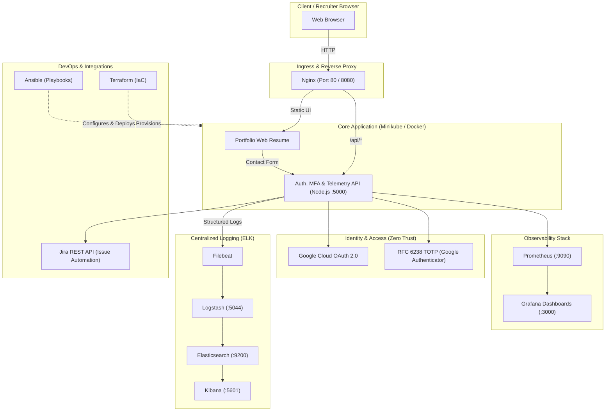

# Mogili Sai Shanmukha Vardhan - Portfolio & DevOps Architecture

An enterprise-grade, modern personal portfolio website and full DevOps architecture showcase featuring **Google OAuth 2.0 Single Sign-On**, **RFC 6238 TOTP Multi-Factor Authentication (2-Step Verification)**, **Docker**, **Minikube (Kubernetes)**, **Terraform (IaC)**, **Ansible**, **Prometheus & Grafana Observability**, **ELK Stack Centralized Logging**, and **Atlassian Jira REST API Integration**.

---

## 🌟 Architecture Overview



---

## 🚀 Key Features

1. **Secured Web Resume (Zero-Trust Gate)**:
   - **Step 1: Google OAuth 2.0 Login**: Sign in securely using your Google account.
   - **Step 2: Two-Step Verification (MFA TOTP)**: Generates a QR code scannable with Google Authenticator or Microsoft Authenticator for 6-digit one-time code verification.
   - **Step 3: Verified Web Resume**: Unlocks the official verified resume, tech stack timeline, and embedded live DevOps telemetry metrics.
   - **Recruiter Sandbox Mode**: 1-click test mode for instant recruiter evaluation without needing whitelist configuration.
2. **Docker & Container Orchestration**:
   - Multi-stage Docker build for backend and optimized Nginx container with reverse-proxying.
   - Full `docker-compose.yml` orchestrating the entire stack.
3. **Observability (Grafana + Prometheus)**:
   - Real-time Prometheus metrics scraping (`/metrics`) for HTTP requests, response latency, auth success/failure rates, and active sessions.
   - Pre-provisioned Grafana dashboard (`portfolio-devops-01`) listening on port `3000`.
4. **Centralized Logging (ELK Stack)**:
   - Structured JSON logs with Winston (`logs/portfolio.log` and `logs/security-audit.log`).
   - Filebeat, Logstash pipeline, Elasticsearch indexing, and Kibana visualizations.
5. **Kubernetes on Minikube**:
   - Ready-to-apply manifests: `k8s/` (`namespace`, `configmap`, `secrets`, `deployments`, `services`, `ingress`, `monitoring`).
   - One-click script: `k8s/deploy-minikube.ps1`.
6. **Terraform Infrastructure as Code (IaC)**:
   - Declarative Kubernetes infrastructure provisioning via `terraform/main.tf` and `terraform.tfvars`.
7. **Ansible Automation**:
   - Automated host validation, container building, health checks, and deployment via `ansible/playbooks/site.yml`.
8. **Jira Cloud REST API Integration**:
   - Contact inquiries submitted through the website automatically create tasks/issues directly on your Jira board.

---

## 🛠️ Quick Start Guide

### Option 1: Docker Compose (All-in-One Local Stack)
```bash
# Start frontend, auth backend, Prometheus, and Grafana:
docker compose up -d --build

# Optional: To include ELK Stack (Elasticsearch, Logstash, Kibana):
docker compose --profile logging up -d
```
- **Portfolio Website**: [http://localhost:8080](http://localhost:8080)
- **Grafana Dashboard**: [http://localhost:3000](http://localhost:3000) (User: `admin`, Pass: `admin`)
- **Prometheus Metrics**: [http://localhost:9090](http://localhost:9090)
- **Auth & Health API**: [http://localhost:5000/health](http://localhost:5000/health)

---

### Option 2: Minikube (Kubernetes Cluster)
```powershell
# Run the 1-click PowerShell deployment script:
.\k8s\deploy-minikube.ps1
```
Or manually:
```bash
kubectl apply -f k8s/00-namespace.yaml
kubectl apply -f k8s/01-configmap.yaml
kubectl apply -f k8s/02-secrets.yaml
kubectl apply -f k8s/03-backend-deployment.yaml
kubectl apply -f k8s/04-backend-service.yaml
kubectl apply -f k8s/05-frontend-deployment.yaml
kubectl apply -f k8s/06-frontend-service.yaml
kubectl apply -f k8s/07-ingress.yaml
kubectl apply -f k8s/monitoring/
```

---

### Option 3: Terraform (IaC Provisioning)
```bash
cd terraform
terraform init
terraform plan
terraform apply -auto-approve
```

---

### Option 4: Ansible Deployment Playbook
```bash
cd ansible
ansible-playbook -i inventory.ini playbooks/site.yml
```

---

## 🔐 Credentials & Secrets Configured

The backend and Kubernetes secrets are pre-configured with your Google OAuth 2.0 credentials:
- **Client ID**: `914232904778-nd0e667q2quue2rvupnkco5gc50bh0d.apps.googleusercontent.com`
- **Authorized Origin**: `http://localhost:8080`, `http://localhost:5000`
- **Redirect URI**: `http://localhost:5000/api/auth/google/callback`

---

## 📄 License
© 2026 Mogili Sai Shanmukha Vardhan. All Rights Reserved.
